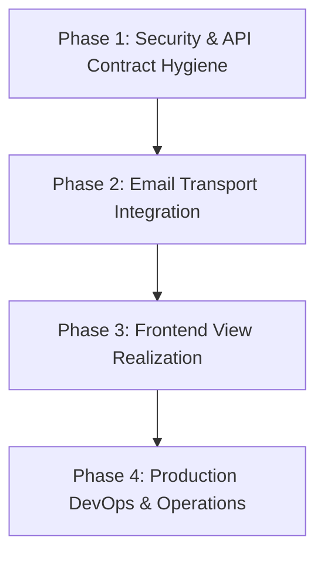

# Baadi Goob (Furan) — Requirements Traceability Matrix (RTM)

**Specification Target**: Furan Software Requirements Specification (MVP) Version 1.2  
**Repository Branch**: `main`  
**Latest Merge Commit**: `ba88c8cbb17e42dbb9948b9a6ccfc08af6ed9f28`  
**Document Status**: Official MVP Requirements Traceability & Verification Audit  
**Companion Documents**:
- [Technical Handover Document](TECHNICAL_HANDOVER.md)
- [Developer Setup and Environment Guide](DEVELOPMENT_SETUP.md)
- [OpenAPI Specification](openapi.yaml)

---

## Table of Contents
1. [Purpose and Scope](#1-purpose-and-scope)
2. [Status Evaluation Criteria and Methodology](#2-status-evaluation-criteria-and-methodology)
3. [Compliance Summary and Status Dashboard](#3-compliance-summary-and-status-dashboard)
4. [Functional Requirements Traceability Matrix (FR-001 to FR-023)](#4-functional-requirements-traceability-matrix-fr-001-to-fr-023)
5. [Non-Functional Requirements Traceability Matrix (NFR-01 to NFR-13)](#5-non-functional-requirements-traceability-matrix-nfr-01-to-nfr-13)
6. [Cross-Cutting Architectural and Operational Specifications](#6-cross-cutting-architectural-and-operational-specifications)
7. [In-Depth Gap Analysis and Risk Evaluation](#7-in-depth-gap-analysis-and-risk-evaluation)
8. [Prioritized Remediation Roadmap and Dependency Ordering](#8-prioritized-remediation-roadmap-and-dependency-ordering)

---

## 1. Purpose and Scope

This document provides a comprehensive, rigorous **Requirements Traceability Matrix (RTM)** for the **Furan** (internally referenced as **Baadi Goob**) talent and opportunity platform. It correlates every functional, non-functional, and operational requirement stipulated in the official **Furan MVP SRS v1.2** against the actual source code, Prisma database schema, automated integration tests, Docker configurations, and CI pipelines currently in the repository.

### Scope Covered:
- All **23 Functional Requirements** (`FR-001` through `FR-023`).
- All **13 Non-Functional Requirements** (`NFR-01` through `NFR-13`).
- **5 Cross-Cutting Architectural & Operational Specifications** defined in SRS Sections 2.8, 3.1, 7.4, and Part B (DevOps, Data Retention, Security, and OpenAPI contract synchronization).

---

## 2. Status Evaluation Criteria and Methodology

To guarantee factual integrity, requirements are evaluated strictly against empirical evidence in the source tree using distinct implementation dimensions:

### 2.1 Multidimensional Status Model
For every functional requirement, three separate statuses are recorded:
1. **Backend/API Status**: Evaluates whether the Express router, controller, domain service, database schema, constraints, and automated integration tests exist and pass.
2. **Frontend/UI Status**: Evaluates whether real, production-ready React views and user-interaction controls exist in [`frontend/`](../frontend). Where routes render bare placeholder components (e.g. `
Landing Page
`), the status is explicitly recorded as **Not Implemented (Placeholder Scaffold)**.
3. **Overall Compliance Status**: Reflects full-stack compliance with the SRS requirement from the perspective of an end-user.

### 2.2 Definitions of Statuses
- **Implemented**: The requirement is fully realized in the codebase. Business logic, database constraints, input validations, and automated integration tests completely satisfy the specification with zero identified functional gaps.
- **Partially Implemented**: Core business logic or backend APIs are implemented and verified, but specific required delivery components remain missing (e.g., backend API is complete with tests, but the frontend view is a placeholder stub; in-database notifications are created, but outbound email delivery is not connected; or soft-deletion is implemented, but the automated 12-month purge worker is absent).
- **Not Implemented**: The requirement or delivery component is explicitly demanded by the MVP SRS, but no corresponding implementation exists in the repository.
- **Unable to Verify**: The requirement cannot be conclusively validated within the local repository artifacts (e.g., requires longitudinal 30-day production telemetry, real-world 3G mobile network latency testing, or subjective visual user-testing of non-existent UI screens).

> **Evaluation Rule**: A valid OpenAPI YAML file or passing schema validation is **not** treated as proof of implementation. Statuses reflect actual runtime code and test execution. In-database record generation is explicitly distinguished from external email delivery.

---

## 3. Compliance Summary and Status Dashboard

### 3.1 Formal SRS Requirements Compliance (FR + NFR)

| Requirement Category | Total Reviewed | Implemented | Partially Implemented | Not Implemented | Unable to Verify |
| :--- | :---: | :---: | :---: | :---: | :---: |
| **Functional Requirements (FR-001 to FR-023)** | 23 | 0 | 23 | 0 | 0 |
| **Non-Functional Requirements (NFR-01 to NFR-13)** | 13 | 3 | 3 | 1 | 6 |
| **Total Formal Requirements** | **36** | **3** | **26** | **1** | **6** |

### 3.2 Functional Requirements Delivery Breakdown (Backend vs. Frontend)

| Subsystem Dimension | Implemented | Partially Implemented | Not Implemented | Total |
| :--- | :---: | :---: | :---: | :---: |
| **Backend / API Implementation** | 18 | 5 | 0 | 23 |
| **Frontend / UI Implementation** | 0 | 0 | 23 | 23 |
| **Overall Full-Stack Compliance** | 0 | 23 | 0 | 23 |

*Note on Backend Status*: 18 FR backend APIs are 100% complete and tested. 5 FRs have specific backend subsystem gaps:
- `FR-014` & `FR-019`: In-database notification created, but outbound email delivery is not wired.
- `FR-016`: Login implemented, but stateless JWT lacks a backend logout endpoint, and refresh token rotation is omitted.
- `FR-017`: Reset token/hash created and verified, but email delivery is not wired.
- `FR-020`: Soft-delete anonymization transaction implemented, but automated 12-month purge worker is absent.

### 3.3 Cross-Cutting Architecture Specifications (Evaluated Separately)

| Specification Area | Total Evaluated | Implemented | Partially Implemented | Not Implemented |
| :--- | :---: | :---: | :---: | :---: |
| **Cross-Cutting Specifications** | 5 | 1 | 4 | 0 |

*(Token Lifecycle, CORS Policy, OpenAPI Contract Parity, 12-Month Purge Worker, and Outbound Email Transport).*

---

## 4. Functional Requirements Traceability Matrix (FR-001 to FR-023)

| ID | Actor | SRS Requirement Description | Priority | Backend/API Status | Frontend/UI Status | Overall Status | Source Evidence (Code, Routes, Tests) | Identified Gaps & Nuances | Recommended Next Action |
| :--- | :--- | :--- | :---: | :---: | :---: | :---: | :--- | :--- | :--- |
| **FR-001** | Student | Register account using email and password. | High | **Implemented** | **Not Implemented** | **Partially Implemented** | • Route: `POST /api/v1/auth/register` • Controller: [`auth.controller.ts`](../backend/src/controllers/auth.controller.ts) • Service: [`auth.service.ts`](../backend/src/services/auth.service.ts) • Tests: [`tests/auth.test.ts`](../backend/tests/auth.test.ts) (48 tests) | Backend fully implemented with bcrypt hashing (10 rounds) and duplicate email rejection. Frontend `/register` route in [`frontend/src/App.tsx`](../frontend/src/App.tsx) renders a placeholder `
Register
`. OpenAPI lists split route `/auth/register/student`. | Implement React registration form in frontend; align OpenAPI contract with unified `/auth/register`. |
| **FR-002** | Student | Create and edit profile including education, skills, and project links. | High | **Implemented** | **Not Implemented** | **Partially Implemented** | • Routes: `GET, PUT /api/v1/students/me/profile` • Controller: [`profile.controller.ts`](../backend/src/controllers/profile.controller.ts) • Model: `StudentProfile` in [`schema.prisma`](../backend/prisma/schema.prisma) • Tests: [`tests/profile.test.ts`](../backend/tests/profile.test.ts) (28 tests) | Backend supports JSON skill arrays and project URL validation. Frontend `/student/profile` route renders placeholder component. | Build React profile editor with dynamic skill tag inputs and URL format validation. |
| **FR-003** | Student | Browse and filter opportunities by type, skill, and deadline. | High | **Implemented** | **Not Implemented** | **Partially Implemented** | • Route: `GET /api/v1/opportunities` • Controller: [`opportunity.controller.ts`](../backend/src/controllers/opportunity.controller.ts) • Index: `@@index([type, status, deadline])` • Tests: [`tests/opportunity.test.ts`](../backend/tests/opportunity.test.ts) (91 tests) | Backend filters by `type`, `skill`, future `deadline`, and pagination. Frontend `/opportunities` route renders placeholder component. | Implement opportunities listing view with filter sidebar and pagination controls. |
| **FR-004** | Student | Apply to an opportunity using saved profile. | High | **Implemented** | **Not Implemented** | **Partially Implemented** | • Route: `POST /api/v1/opportunities/:id/applications` • Controller: [`application.controller.ts`](../backend/src/controllers/application.controller.ts) • Service: [`opportunity.service.ts`](../backend/src/services/opportunity.service.ts) • Model: `Application` • Tests: [`tests/application.test.ts`](../backend/tests/application.test.ts) (64 tests) | Backend enforces prerequisites: student must have >= 1 skill, opportunity must be `OPEN`, deadline must not be passed. Frontend Apply button not implemented. | Build Opportunity Details view with interactive profile verification modal and Apply action. |
| **FR-005** | Student | View status of each application (New, Shortlisted, Rejected, Hired). | High | **Implemented** | **Not Implemented** | **Partially Implemented** | • Route: `GET /api/v1/students/me/applications` • Controller: [`application.controller.ts`](../backend/src/controllers/application.controller.ts) • Enum: `ApplicationStatus` in `schema.prisma` • Tests: [`tests/application.test.ts`](../backend/tests/application.test.ts) | Backend returns full application history with opportunity metadata and statuses. Frontend `/student/applications` is a placeholder. | Create student application tracker view with colored status badges (`NEW`, `SHORTLISTED`, `REJECTED`, `HIRED`). |
| **FR-006** | Student | Register for a listed competition. | Medium | **Implemented** | **Not Implemented** | **Partially Implemented** | • Route: `POST /api/v1/opportunities/:id/registrations` • Controller: [`registration.controller.ts`](../backend/src/controllers/registration.controller.ts) • Service: [`opportunity.service.ts`](../backend/src/services/opportunity.service.ts) • Model: `CompetitionRegistration` • Tests: [`tests/registration.test.ts`](../backend/tests/registration.test.ts) (36 tests) | Backend enforces type constraint (`type === COMPETITION`), deadline check, and duplicate rejection. Frontend `/competitions` is a placeholder. | Build competition card components with instant one-click registration flow. |
| **FR-007** | Business | Register account and create company profile. | High | **Implemented** | **Not Implemented** | **Partially Implemented** | • Routes: `POST /api/v1/auth/register`, `GET, PUT /api/v1/businesses/me/profile` • Controller: [`profile.controller.ts`](../backend/src/controllers/profile.controller.ts) • Model: `BusinessProfile` • Tests: [`tests/profile.test.ts`](../backend/tests/profile.test.ts) | Backend initializes business with `verification_status: PENDING`. Frontend `/business/profile` renders placeholder. OpenAPI specifies split path `/auth/register/business`. | Create company profile management page in frontend; align OpenAPI schema. |
| **FR-008** | Business | Post an opportunity specifying type, title, required skills, and deadline. | High | **Implemented** | **Not Implemented** | **Partially Implemented** | • Route: `POST /api/v1/opportunities` • Controller: [`opportunity.controller.ts`](../backend/src/controllers/opportunity.controller.ts) • Middleware: [`verifiedBusiness.middleware.ts`](../backend/src/middleware/verifiedBusiness.middleware.ts) • Tests: [`tests/opportunity.test.ts`](../backend/tests/opportunity.test.ts) | Backend strictly blocks unverified businesses (HTTP 403) and validates future deadline. Frontend `/business/opportunities/new` is a placeholder. | Create multi-step opportunity authoring form in frontend with validation. |
| **FR-009** | Business | View list of applicants for each posted opportunity. | High | **Implemented** | **Not Implemented** | **Partially Implemented** | • Route: `GET /api/v1/opportunities/:id/applications` • Controller: [`application.controller.ts`](../backend/src/controllers/application.controller.ts) • Tests: [`tests/application.test.ts`](../backend/tests/application.test.ts) | Backend enforces ownership (`posted_by === req.user.id`); reveals student profile only upon application. Frontend applicants table is a placeholder. | Build employer applicant review dashboard with candidate profile modal. |
| **FR-010** | Business | Change applicant's status (Shortlisted, Rejected, Hired). | High | **Implemented** | **Not Implemented** | **Partially Implemented** | • Route: `PATCH /api/v1/applications/:id/status` • Controller: [`application.controller.ts`](../backend/src/controllers/application.controller.ts) • Service: [`application.service.ts`](../backend/src/services/application.service.ts) • Tests: [`tests/application.test.ts`](../backend/tests/application.test.ts) | Backend updates status in atomic transaction and dispatches in-database student notification. Frontend UI controls missing. | Implement applicant status dropdown / action buttons on employer dashboard. |
| **FR-011** | Business | Edit or close a posted opportunity. | Medium | **Implemented** | **Not Implemented** | **Partially Implemented** | • Routes: `PUT /api/v1/opportunities/:id`, `POST /api/v1/opportunities/:id/close` • Controller: [`opportunity.controller.ts`](../backend/src/controllers/opportunity.controller.ts) • Tests: [`tests/opportunity.test.ts`](../backend/tests/opportunity.test.ts) | Backend verifies ownership and transitions opportunity to `CLOSED`. Frontend edit/close controls are placeholders. | Implement opportunity management actions (Edit / Close / Delete) on business dashboard. |
| **FR-012** | Admin | Verify or reject newly registered business account. | High | **Implemented** | **Not Implemented** | **Partially Implemented** | • Routes: `GET /api/v1/admin/businesses`, `PATCH /api/v1/admin/businesses/:id/verification` • Controller: [`admin.controller.ts`](../backend/src/controllers/admin.controller.ts) • Tests: [`tests/admin.test.ts`](../backend/tests/admin.test.ts) (59 tests) | Backend supports filtering pending businesses, updating status, and generating in-database notification. Frontend `/admin/businesses` is a placeholder. | Implement administrative business verification review panel in frontend. |
| **FR-013** | Admin | Remove an opportunity listing violating platform policy. | Medium | **Implemented** | **Not Implemented** | **Partially Implemented** | • Route: `DELETE /api/v1/opportunities/:id` • Controller: [`opportunity.controller.ts`](../backend/src/controllers/opportunity.controller.ts) • Service: [`opportunity.service.ts`](../backend/src/services/opportunity.service.ts) • Tests: [`tests/opportunity.test.ts`](../backend/tests/opportunity.test.ts) | Backend permits deletion by either the posting business owner or an Administrator (`Role.ADMIN`). Frontend UI is a placeholder. | Add moderation removal buttons for administrators on opportunity listings. |
| **FR-014** | System | Send notification to student when application status changes. | High | **Partially Implemented** | **Not Implemented** | **Partially Implemented** | • Service: [`application.service.ts`](../backend/src/services/application.service.ts) • Model: `Notification` • Tests: [`tests/application.test.ts`](../backend/tests/application.test.ts) | Backend creates atomic `Notification` record in MySQL (`type: "APPLICATION_STATUS_UPDATE"`, `channel: "EMAIL"`). **Outbound email delivery is not configured**. Frontend notification view is absent. | Wire Nodemailer or external transactional email service (AWS SES, Resend) to deliver live emails. |
| **FR-015** | System | Prevent student from submitting more than one application to same opportunity. | High | **Implemented** | **Not Implemented** | **Partially Implemented** | • Schema: `@@unique([student_id, opportunity_id])` in `schema.prisma` • Service: [`opportunity.service.ts`](../backend/src/services/opportunity.service.ts) • Tests: [`tests/application.test.ts`](../backend/tests/application.test.ts) | Backend duplicate prevention is fully implemented via pre-check (throwing HTTP 409) and database composite unique constraint. However, SRS Section 3.1 also specifies frontend behavior (*"show an 'Already applied' message"*), which is missing due to placeholder UI. | Implement disabled "Already Applied" button state and feedback banner on frontend opportunity details view. |
| **FR-016** | All users | Log in and log out using email and password. | High | **Partially Implemented** | **Not Implemented** | **Partially Implemented** | • Route: `POST /api/v1/auth/login` • Controller: [`auth.controller.ts`](../backend/src/controllers/auth.controller.ts) • Middleware: [`rateLimiter.ts`](../backend/src/middleware/rateLimiter.ts) • Tests: [`tests/auth.test.ts`](../backend/tests/auth.test.ts) | Login fully implemented with rate limiting (10 req/15m) and status checks. **Logout is client-managed stateless JWT** (no backend `/auth/logout` endpoint). No refresh tokens (SRS Section 2.8). Frontend login is a placeholder. | Build React login form; reconcile OpenAPI spec by removing phantom `/auth/logout` endpoint. |
| **FR-017** | All users | Reset forgotten password using a link sent to email. | Medium | **Partially Implemented** | **Not Implemented** | **Partially Implemented** | • Routes: `POST /api/v1/auth/password-reset`, `POST /api/v1/auth/password-reset/confirm` • Controller: [`auth.controller.ts`](../backend/src/controllers/auth.controller.ts) • Model: `PasswordResetToken` • Tests: [`tests/auth.test.ts`](../backend/tests/auth.test.ts) | Backend creates 32-byte secure token, SHA-256 hash in MySQL, 15m expiration, rate-limited (5 req/15m). **Reset link is not emailed externally**. Frontend forms are placeholders. | Connect outbound email transport adapter to email reset URLs containing the token; build frontend reset forms. |
| **FR-018** | Business | View list of students registered for competition posted by business. | Medium | **Implemented** | **Not Implemented** | **Partially Implemented** | • Route: `GET /api/v1/opportunities/:id/registrations` • Controller: [`registration.controller.ts`](../backend/src/controllers/registration.controller.ts) • Tests: [`tests/registration.test.ts`](../backend/tests/registration.test.ts) | Backend verifies ownership or Admin role and returns student registrant details. Frontend UI is a placeholder. | Build registrant roster table on competition management page in frontend. |
| **FR-019** | System | Send notification to business when account is verified or rejected. | High | **Partially Implemented** | **Not Implemented** | **Partially Implemented** | • Service: [`admin.service.ts`](../backend/src/services/admin.service.ts) • Model: `Notification` • Tests: [`tests/admin.test.ts`](../backend/tests/admin.test.ts) | Atomic MySQL `Notification` record created (`type: "BUSINESS_VERIFICATION"`, `channel: "EMAIL"`). **Outbound email delivery is not configured**. | Wire outbound email transport to deliver verification approval/rejection emails. |
| **FR-020** | All users | Allow student or business to delete own account. | Low | **Partially Implemented** | **Not Implemented** | **Partially Implemented** | • Route: `DELETE /api/v1/users/me` • Controller: [`user.controller.ts`](../backend/src/controllers/user.controller.ts) • Service: [`user.service.ts`](../backend/src/services/user.service.ts) • Migration: `20261016204956_add_deleted_user_status` • Tests: [`tests/user.test.ts`](../backend/tests/user.test.ts) (13 tests) | Atomic soft-delete: PII anonymized (`Deleted User`), email scrubbed (`deleted_<id>@deleted.local`), profile purged, applications retained. **Automated 12-month purge cron worker is missing**. Frontend settings view missing. | Implement a scheduled background worker to permanently purge records older than 12 months. |
| **FR-021** | Admin | View all users and suspend or reactivate an account. | Medium | **Implemented** | **Not Implemented** | **Partially Implemented** | • Routes: `GET /api/v1/admin/users`, `PATCH /api/v1/admin/users/:id/status` • Controller: [`admin.controller.ts`](../backend/src/controllers/admin.controller.ts) • Tests: [`tests/admin.test.ts`](../backend/tests/admin.test.ts) | Backend filters by role/status, prevents admin self-suspension, invalidates existing tokens immediately via middleware. Frontend `/admin/manage` is a placeholder. | Build user management table with search and suspend/reactivate toggles. |
| **FR-022** | All users | Show logged-in user dashboard for role with summary counts. | Medium | **Implemented** | **Not Implemented** | **Partially Implemented** | • Route: `GET /api/v1/dashboard/summary` • Controller: [`dashboard.controller.ts`](../backend/src/controllers/dashboard.controller.ts) • Service: [`dashboard.service.ts`](../backend/src/services/dashboard.service.ts) • Tests: [`tests/dashboard.test.ts`](../backend/tests/dashboard.test.ts) (12 tests) | Backend calculates role-specific summaries (Student: status breakdown; Business: applicants/hired; Admin: pending businesses/total users). Frontend dashboard routes render bare placeholders. | Construct role-tailored dashboard metric cards and summary charts in React. |
| **FR-023** | Student | Search opportunities by keyword. | Medium | **Implemented** | **Not Implemented** | **Partially Implemented** | • Route: `GET /api/v1/opportunities?q=keyword` • Controller: [`opportunity.controller.ts`](../backend/src/controllers/opportunity.controller.ts) • Index: `@@fulltext([title, description])` in `schema.prisma` • Tests: [`tests/opportunity.test.ts`](../backend/tests/opportunity.test.ts) | Backend executes MySQL boolean fulltext search across title and description combined with filters. Frontend search bar is a placeholder. | Integrate search bar with debounced query calls in frontend opportunity catalog. |

---

## 5. Non-Functional Requirements Traceability Matrix (NFR-01 to NFR-13)

| ID | Category | SRS Requirement Description | Status | Source Evidence (Code, Config, Tests) | Identified Gaps & Nuances | Recommended Next Action |
| :--- | :--- | :--- | :---: | :--- | :--- | :--- |
| **NFR-01** | Security | Store passwords using one-way salted hash; encrypt data in transit via HTTPS. | **Partially Implemented** | • Passwords: `bcryptjs.hash(..., 10)` in [`auth.service.ts`](../backend/src/services/auth.service.ts) and [`seed.ts`](../backend/prisma/seed.ts) • In-Transit: Nginx proxy in [`docker-compose.yml`](../docker-compose.yml) | Password hashing is fully implemented and tested. HTTPS termination is architected via Nginx reverse proxy, but SSL/TLS certificates (Let's Encrypt) are a production hosting deployment step. | Configure automated Certbot / Let's Encrypt certificate renewal on production server. |
| **NFR-02** | Performance | Respond to standard request within 3 seconds under normal conditions on 3G. | **Unable to Verify** | • Composite indexes in [`schema.prisma`](../backend/prisma/schema.prisma) • Pagination controls | Database queries utilize composite indexes and pagination. However, real-world 3G mobile network latency and full-page client asset load times cannot be verified without a deployed frontend and network throttling tests. Local execution speed on high-spec developer machines cannot substitute for 3G performance testing. | Run Google Lighthouse and WebPageTest with 3G network emulation against staging deployment. |
| **NFR-03** | Availability | Maintain at least 99% uptime per month, excluding scheduled maintenance. | **Unable to Verify** | • Container health checks in [`docker-compose.yml`](../docker-compose.yml) • Crash handlers in [`server.ts`](../backend/src/server.ts) | Requires longitudinal production runtime telemetry over a continuous 30-day operating window. | Hook `/api/v1/health` into external multi-region ping monitors (e.g., UptimeRobot, Datadog). |
| **NFR-04** | Reliability | Preserve application data without loss in event of server restart. | **Implemented** | • Named Docker volume: `mysql_data:/var/lib/mysql` in [`docker-compose.yml`](../docker-compose.yml) • InnoDB engine | Relational data is persisted to host filesystem volume via Docker named volume; verified to survive container restarts and host reboots. Note: This supports persistence across container restarts but is not proof of disaster recovery, automated backups, or recovery from host disk failure. | Implement automated backups (`NFR-10`) to satisfy disaster recovery requirements. |
| **NFR-05** | Usability | First-time student able to complete profile creation in 5 steps or fewer. | **Unable to Verify** | • Single endpoint: `PUT /api/v1/students/me/profile` takes all fields in 1 call | API requires only 1 request, but UI multi-step wizard is currently a placeholder (`
Student Profile
`). User testing pending frontend completion. | Design profile creation wizard with a maximum of 3–4 step progress indicators. |
| **NFR-06** | Accessibility | Support readable text sizing and sufficient color contrast for low-vision users. | **Unable to Verify** | • Tailwind CSS v4 in [`frontend/package.json`](../frontend/package.json) | Frontend views currently render unstyled placeholder text. Automated accessibility testing (e.g. axe-core) cannot be evaluated yet. | Enforce WCAG 2.1 AA compliant color palette tokens and test via axe-core in CI. |
| **NFR-07** | Scalability | Support at least 5,000 registered student users without architectural changes. | **Unable to Verify** | • B-tree indexes on `User(email)`, `Application(student_id, opportunity_id)` • Fulltext index on `Opportunity` • Stateless JWT | Normalized schema and database indexing are present and architecturally designed for scale. However, no formal load test or benchmark with 5,000 synthetic users exists in the repository to empirically validate the SRS target. | Conduct load and performance testing with 5,000 simulated student accounts using k6 or Artillery. |
| **NFR-08** | Maintainability | Built with modular components so individual features update independently. | **Implemented** | • Decoupled folders: `routes/`, `controllers/`, `services/`, `validations/` • 13 modular test suites | Code is cleanly structured by architectural layer with high cohesion and loose coupling. | Maintain established modular pattern when authoring future services. |
| **NFR-09** | Data Privacy | Do not share student personal data with business until student submits application. | **Implemented** | • Route protection in [`student.routes.ts`](../backend/src/routes/student.routes.ts) • Filtered projection in [`opportunity.service.ts`](../backend/src/services/opportunity.service.ts) | Verified by code and test: no public student directory exists. Businesses can only inspect applicants who explicitly applied to their own posting. | None. Verified by access-control tests. |
| **NFR-10** | Backup & Recovery | Daily automated database backup retained for at least 30 days. | **Not Implemented** | • No backup cron script or cloud storage uploader in repository | MySQL container stores data locally, but no automated scheduled `mysqldump` or S3/cloud backup pipeline exists. | Create a scheduled backup container / cron script executing automated daily encrypted backups. |
| **NFR-11** | Compatibility | Work on modern Chrome, Safari, Firefox, and screens as small as 360 px wide. | **Unable to Verify** | • Responsive viewport meta tag in [`frontend/index.html`](../frontend/index.html) | Responsive viewport is configured, but complete views are not yet built to test cross-browser or mobile rendering. | Perform Playwright cross-browser and mobile viewport testing during frontend development. |
| **NFR-12** | Deployment | Automated pipeline, separate staging environment tested before production release. | **Partially Implemented** | • CI Pipeline: [`.github/workflows/ci.yml`](../.github/workflows/ci.yml) (lint, typecheck, test, build) | CI automation runs on every push/PR to `main`. However, **CD pipeline and staging deploy automation are not configured**. | Add GitHub Actions deployment jobs for automated staging deploys and production tagging. |
| **NFR-13** | Monitoring | Write error logs and alert team within 5 minutes when production stops responding. | **Partially Implemented** | • Structured logs: `pino` & `pino-http` • Endpoint: `GET /api/v1/health` in [`app.ts`](../backend/src/app.ts) | Centralized JSON logging and health probe are fully implemented. **External 5-minute alerting infrastructure is not configured**. | Connect `/health` endpoint to external monitoring service with email/SMS incident alerting. |

---

## 6. Cross-Cutting Architectural and Operational Specifications

These items represent cross-cutting architectural mandates defined in SRS Sections 2.8, 3.1, 7.4, and Part B. They are evaluated separately from the formal FR and NFR totals:

| Specification Area | SRS Section Reference | Documented Requirement | Actual Repository Implementation | Compliance Status | Remediation Required |
| :--- | :--- | :--- | :--- | :---: | :--- |
| **Authentication & Tokens** | Section 2.8 & B3.1 | "JWT access and refresh tokens" | Stateless HMAC SHA-256 JWT access tokens with a **fixed 15-minute default expiration (`15m`)**; no refresh tokens or rotation. | **Partially Implemented** | Either introduce refresh tokens with database/Redis rotation, or formally update SRS to document short-lived access tokens. |
| **CORS Security** | Section B3.2 | "CORS limited to the frontend domain" | Centralized, environment-aware origin policy in [`backend/src/common/cors.ts`](../backend/src/common/cors.ts) and [`backend/src/app.ts`](../backend/src/app.ts) restricts browser access to `FRONTEND_URL`, normalizes trailing slashes, permits loopback origins in non-production, enforces least privilege by omitting ambient credentials for stateless Bearer tokens, handles preflight `OPTIONS`, and fails fast on missing production configuration. Regression tested in [`app.test.ts`](../backend/tests/app.test.ts). | **Implemented** | None. Centralized CORS middleware and CI/test environment configuration verified. |
| **OpenAPI Contract Parity** | Section 2.8 & B4 | Shared OpenAPI specification matching backend endpoints | Discrepancies in [`docs/openapi.yaml`](openapi.yaml): split registration routes documented vs unified in code; `/auth/me` omitted; `/auth/logout` phantom. | **Partially Implemented** | Update `docs/openapi.yaml` to match Express routes: unify `/auth/register`, document `/auth/me`, remove `/auth/logout`. |
| **12-Month Retention Purge** | Section 7.4 | Retain application data for 12 months; delete personal details; purge after 12 months | Account deletion (FR-020) soft-deletes and anonymizes records immediately. No scheduled background worker exists to purge records > 12 months old. | **Partially Implemented** | Implement automated recurring task (e.g. node-cron or worker container) to delete records where `deleted_at < NOW() - INTERVAL 12 MONTH`. |
| **Outbound Email Delivery** | Section 2.5, 6.2, B3.1 | Email delivery for status changes and account verification via Nodemailer | In-database `Notification` records and `PasswordResetToken` hashes are created, but no SMTP or email transport is wired. | **Partially Implemented** | Implement email transport adapter using Nodemailer (configured with AWS SES, SendGrid, or SMTP). |

---

## 7. In-Depth Gap Analysis and Risk Evaluation

### 7.1 Critical Gaps (Direct Functional Impact)

1. **Outbound Email Transport (Affects FR-014, FR-017, FR-019)**:
   - *Current State*: Password reset tokens and notification messages are written to MySQL tables, but never leave the server.
   - *User Impact*: Users who click "Forgot Password" cannot receive an email reset link. Students and businesses receive no real-time email updates when application statuses change or business accounts are approved.
   - *Risk Level*: **High (Launch Blocker)**.

2. **Frontend Views Scaffold State (Affects All User-Facing FRs)**:
   - *Current State*: The frontend has a modern React 19 / Vite / Tailwind setup and route guards, but pages render bare text placeholders.
   - *User Impact*: End users cannot currently interact with the application via a web browser.
   - *Risk Level*: **High (Launch Blocker)**.

### 7.2 Security & Contract Gaps

1. **CORS Unrestricted Ingress (Remediated)**:
   - *Current State*: Centralized environment-aware CORS middleware (`backend/src/common/cors.ts`) enforces origin restrictions against `FRONTEND_URL`, normalizes trailing slashes, enforces least privilege by omitting ambient credentials for stateless Bearer tokens, and guards against missing production configuration.
   - *Risk Level*: **Resolved**.
2. **OpenAPI Specification Drift**:
   - *Current State*: Contract discrepancies between `openapi.yaml` and Express routes (split registration paths, missing `/auth/me`, phantom `/auth/logout`).
   - *Risk Level*: **Low to Medium**. Causes frontend TypeScript SDK generators to create incorrect API clients.

### 7.3 Operational & Infrastructure Gaps

1. **Absence of Automated Backups (NFR-10)**:
   - *Current State*: Data is kept in Docker named volume `mysql_data`, but no daily backup dump or offsite copy is scheduled.
   - *Risk Level*: **High for Production**. Server hardware failure or storage corruption would cause total data loss.
2. **Missing 12-Month Retention Purge Worker (FR-020, SRS Section 7.4)**:
   - *Current State*: Soft-deleted accounts remain anonymized indefinitely.
   - *Risk Level*: **Low**. Does not impact initial MVP launch, but must be addressed within the first operational year to meet privacy compliance.
3. **No External Uptime Alerting Hook (NFR-13)**:
   - *Current State*: The `/api/v1/health` endpoint exists, but is not being polled by an external alerting daemon.
   - *Risk Level*: **Medium for Production**. Outages will not trigger automated alerts to engineers within the 5-minute requirement.

---

## 8. Prioritized Remediation Roadmap and Dependency Ordering

To achieve 100% compliance with SRS v1.2 for public launch, remediations should be executed in the following strict dependency order:

### Phase 1: Security & API Contract Hygiene (Immediate)
1. **Harden CORS in `backend/src/app.ts` (Completed)**:
   - Centralized environment-aware `FRONTEND_URL` origin restriction implemented via `backend/src/common/cors.ts` (with least-privilege credential handling) and verified with regression tests.
2. **Synchronize `docs/openapi.yaml`**:
   - Unify `POST /auth/register` schema; remove split `/auth/register/student` and `/auth/register/business`.
   - Document `GET /auth/me`.
   - Remove phantom `POST /auth/logout` or add token invalidation.

### Phase 2: Email Transport Integration (Backend Blocker)
1. **Implement Nodemailer Transport**:
   - Create `backend/src/lib/email.ts` supporting standard SMTP credentials (`SMTP_HOST`, `SMTP_PORT`, `SMTP_USER`, `SMTP_PASS`).
   - Hook email dispatcher into `auth.service.ts` for password reset delivery.
   - Hook notification dispatcher into `application.service.ts` and `admin.service.ts`.

### Phase 3: Frontend View Realization (Client Blocker)
1. **Build Core Shared UI Components**:
   - Modals, form inputs, status badges, navbar, and error toasts.
2. **Implement User Flows**:
   - Authentication (Login, Registration, Forgot Password).
   - Opportunity Catalog (Filters, Fulltext Search, Detail view, Apply button).
   - Dashboards (Student, Business, Admin metric cards).
   - Management Views (Applicant reviewer, Business verification panel).

### Phase 4: Production DevOps & Operations (Pre-Launch)
1. **Automated Database Backup (NFR-10)**:
   - Create a daily backup cron container dumping MySQL to encrypted cloud storage with a 30-day lifecycle retention policy.
2. **Automated 12-Month Purge Worker (FR-020)**:
   - Schedule a monthly maintenance task executing:
     `DELETE FROM Application WHERE user.deleted_at < NOW() - INTERVAL 12 MONTH`.
3. **Continuous Deployment (NFR-12)**:
   - Extend `.github/workflows/ci.yml` with container build and deployment jobs targeting staging.
4. **External Uptime Monitoring (NFR-13)**:
   - Register `https://<api-domain>/api/v1/health` with an external monitoring service alerting team members on failure within 5 minutes.
